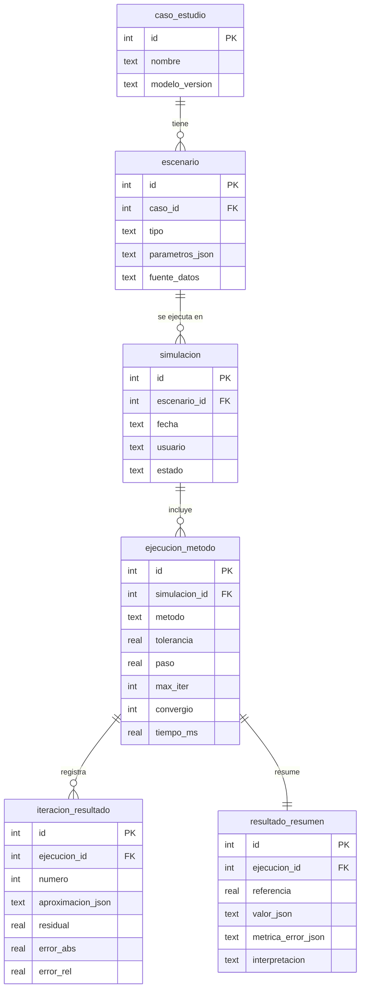

# SIMTELE-RISK

Simulador **educativo** de métodos numéricos aplicado a cuatro problemas de transporte por cable.
Compara métodos implementados desde cero en tres escenarios: **NORMAL**, **ESTRÉS** y **MAL CONDICIONADO**.

> Proyecto académico. **Todos los datos y parámetros son sintéticos**; no representan equipos ni datos reales.

## Alcance de esta entrega: Semana 1 (modelos y primeros algoritmos)

| Requisito | Dónde está |
|-----------|-----------|
| Planteamiento de los cuatro casos y relación modelo–método | `modules/m*.py` (`META`), tabla en la página de inicio, informe en `docs/` |
| Teoría de errores transversal | `numerics/errors.py` (absoluto, relativo, residuo, amplificación) |
| Sistemas lineales: Jacobi, Gauss-Seidel, LU, gradiente conjugado y solución de referencia | `numerics/linear.py` |
| Pruebas de los tres escenarios en al menos un caso; escenarios de los otros tres definidos | Módulo 2 ejecuta NORMAL / ESTRÉS / MAL; los módulos 1, 3 y 4 tienen sus escenarios y parámetros definidos |
| Prototipo web con cuatro módulos visibles | `app.py` + `templates/` |
| DER inicial | `db/schema.sql` (diagrama más abajo) |
| Avance en PDF | `docs/Semana_1_Informe_SIMTELE_RISK.docx` (exportar a PDF para la entrega) |

## Módulos

| # | Caso de estudio | Estado (Semana 1) | Métodos de la Semana 1 | Métodos planeados (semanas 2-3) |
|---|-----------------|-------------------|------------------------|---------------------------------|
| 1 | Detención de emergencia | Planteado | — | RK2, RK4, trapecio, Simpson, Romberg, bisección, Newton, secante |
| 2 | Deterioro y mantenimiento | **Implementado** | Jacobi, Gauss-Seidel, LU, gradiente conjugado, errores | Bisección, Newton, secante |
| 3 | Oscilaciones por viento | Planteado | — | RK2, RK4, trapecio, Simpson, Romberg |
| 4 | Señales de sensores | Planteado | — | Lagrange, Newton, spline, bisección, Newton, secante |

El Módulo 2 muestra: parámetros validados, matriz y solución de referencia, comparación de métodos (iteraciones, residuo,
error), tablas de iteraciones, sensibilidad, gráficos y **dos conclusiones separadas** (numérica y del problema).

## Requisitos

Python 3.10 o superior.

## Instalación y ejecución

```bash
git clone https://github.com/Josselmen/simtele-risk.git
cd simtele-risk
python -m venv .venv
# Windows:  .venv\Scripts\activate        Linux/Mac:  source .venv/bin/activate
pip install -r requirements.txt
python app.py
```

Abrir <http://127.0.0.1:5000> en el navegador. La base de datos `db/simtele.db` se crea sola al iniciar.

## Pruebas

```bash
python -m pytest -q
```

Verifican los errores, los cuatro métodos de sistemas lineales (mismo resultado en un sistema 4×4 con solución conocida,
CG en n pasos, Jacobi divergente con Hilbert, CG rechazando matrices no SPD), el Módulo 2 en sus tres escenarios, la
validación de parámetros, el esquema de la base de datos y las rutas web.

## Estructura

```
simtele-risk/
├── app.py                  # aplicación Flask (rutas)
├── requirements.txt
├── db/
│   ├── schema.sql          # DER inicial: 6 tablas
│   └── database.py         # crea la base de datos y carga los 4 casos
├── numerics/               # SOLO matemática (sin Flask)
│   ├── errors.py           # errores, residuo, amplificación
│   └── linear.py           # LU, Jacobi, Gauss-Seidel, gradiente conjugado
├── modules/                # un archivo por caso de estudio
│   ├── common.py           # validación, tablas, gráficos
│   └── m1_… m4_…           # M2 implementado; M1, M3 y M4 planteados
├── templates/, static/     # páginas HTML (Jinja2) y estilos
├── tests/                  # pruebas con pytest
└── docs/                   # informe de la Semana 1
```

## DER inicial



## Escenarios

- **NORMAL:** configuración nominal con referencia analítica.
- **ESTRÉS:** parámetros extremos, pasos grandes o ruido.
- **MAL CONDICIONADO:** subexperimento numérico con evidencia cuantitativa (en el Módulo 2: matriz de Hilbert, κ y
  amplificación de perturbaciones). Se distingue de un fallo de convergencia.

## Notas técnicas

- Normas: errores y residuos en norma infinito; número de condición en norma 2.
- Iterativos: parada con residuo relativo < tolerancia; Jacobi/Gauss-Seidel hasta 20 000 iteraciones.

## Integrantes

[completar]
